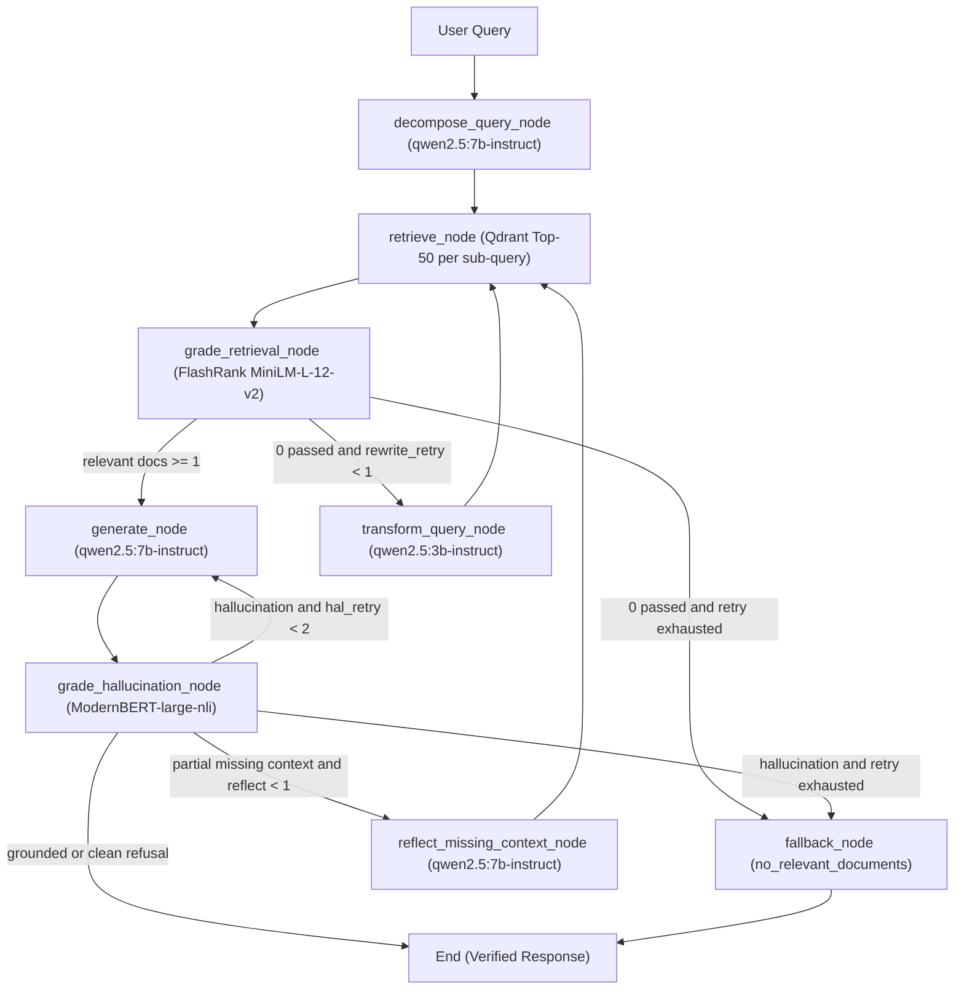

# Self-Reflective Agentic RAG for Regulatory Compliance

A 100% local, zero-API-cost **Agentic Corrective / Self-RAG** pipeline built with LangGraph, Qdrant, Ollama (`qwen2.5:7b-instruct`), FlashRank, `ModernBERT-large-nli`, and Chainlit — rigorously evaluated against a controlled Naive RAG baseline across **436 pages** (**2,325 chunks**) of five real legal and regulatory PDFs (**EU GDPR, EU AI Act, EU NIS2 Directive, U.S. HIPAA 2002 Privacy Rule, and Turkish KVKK Law No. 6698**).

## Table of Contents

- [Headline Results](#headline-results-n--100-controlled-benchmark)
- [Architecture](#architecture)
- [Project Structure](#project-structure)
- [Evaluation Design](#evaluation-design-golden_dataset_100json)
- [Experimental Results](#experimental-results)
- [Engineering Evolution, Ablations & Node-Level ROI](#engineering-evolution-ablations--node-level-roi)
- [Qualitative Case Studies](#qualitative-case-studies)
- [Known Limitations & Future Work](#known-limitations--future-work)
- [Quickstart & Reproducibility](#quickstart--reproducibility)

---

## Headline Results (`n = 100` Controlled Benchmark)

Comparing **Agentic v2** against a controlled single-pass **Naive RAG** baseline sharing the same header-aware Qdrant index and strict grounding prompt (`80` in-scope + `20` out-of-domain / unanswerable queries):

- **60% lower hallucination rate:** `18.8%` (`15/80`) → **`7.5%`** (`6/80`)
- **Higher answer precision among answered queries:** `78.3%` (`54/69`) → **`90.0%`** (`54/60`)
- **Cross-document (2-statute) hit rate:** `53.3%` (`8/15`) → **`86.7%`** (`13/15`); overall target-document hit **`96.2%`** (`77/80`) vs `91.2%` (`73/80`)
- **Deterministic OOD rejection:** `0/8` → **`8/8` (`100%`)** structural cutoffs before generation
- **Independent 32B RAGAS Judge (`qwen2.5:32b` + `bge-m3`):** On positive responses (`Naive n=66` vs `Agentic v2 n=54`), Agentic v2 beats Naive RAG on **all 5 RAGAS metrics** (`Faithfulness: 0.9053 vs 0.8313`, `Context Recall: 0.9025 vs 0.8586`, `Answer Relevancy: 0.8545 vs 0.8115`, `Context Precision: 0.6858 vs 0.6391`, `Answer Correctness: 0.6688 vs 0.6521`)

> **Trade-off summary:** Total useful answers matched (`54/80`, `67.5%`), while safety and cross-document recall came at the cost of higher selective abstention (`20/80` vs `11/80`) and single-machine multi-call latency (`57.90s` vs `35.78s` mean).

---

## Architecture

Instead of an unconstrained open-ended ReAct tool-calling loop, this system implements a **bounded, auditable cyclic StateGraph** (`src/graph.py`) tailored for high-stakes legal compliance — combining query planning, cross-encoder filtering, whole-answer NLI grounding, reflective re-retrieval, and deterministic fallback.



### Tech Stack

| Layer | Implementation |
| :--- | :--- |
| **Orchestration** | `langgraph` (`StateGraph` with typed `GraphState` and append-only `audit_logs`) |
| **Generation & Planning** | Ollama `qwen2.5:7b-instruct` (`temperature=0.0`, `num_ctx=16384`) |
| **Query Rewriting** | Ollama `qwen2.5:3b-instruct` (`SLM`, `num_ctx=2048`) |
| **Embeddings & Vector DB** | `nomic-embed-text` (`768`-dim asymmetric `search_document:` / `search_query:`) + Qdrant |
| **Document Ingestion** | `PyMuPDF4LLM` + Markdown header hierarchy splitter (`CHUNK_SIZE=1600`, `CHUNK_OVERLAP=250`) |
| **Reranker** | FlashRank `ms-marco-MiniLM-L-12-v2` (`max_length=1024`, threshold `0.03` / `0.05` post-rewrite, `TOP_N=8`) |
| **Hallucination Verifier** | `tasksource/ModernBERT-large-nli` (`max_length=8192`, whole-answer vs context, `entail>=0.40`, `contra<0.25`) |
| **UI** | Chainlit (`app.py`) with page-level deduplicated PDF citations, side PDF viewer, and bold passage matching |

### Regulatory Corpus (`436` Pages → `2,325` Chunks)

1. **EU GDPR** (`CELEX_32016R0679_EN_TXT.pdf` — 88 pages)
2. **EU AI Act** (`OJ_L_202401689_EN_TXT.pdf` — 144 pages)
3. **EU NIS2 Directive** (`CELEX_32022L2555_EN_TXT.pdf` — 73 pages)
4. **U.S. HIPAA 2002 Privacy Rule** (`privrulepd.pdf` — 93 pages)
5. **Turkish KVKK Law No. 6698** (`kvkk_law_6698_en.pdf.pdf` — 38 pages, English translation)

---

## Project Structure

```text
.
├── app.py                                # Chainlit UI, source citation deduplication & PDF side viewer
├── main.py                               # Single-query CLI streaming runner for trace debugging
├── config/
│   └── settings.py                       # Centralized env loading, thresholds, retry budgets & cache paths
├── src/
│   ├── graph.py                          # LangGraph StateGraph wiring (nodes, direct & conditional edges)
│   ├── state/state.py                    # Typed GraphState definition with append-only audit_logs
│   ├── indexing/
│   │   ├── loader.py                     # PyMuPDF4LLM Markdown extraction & artifact cleanup
│   │   ├── splitter.py                   # Header-hierarchy + recursive chunking with title breadcrumbs
│   │   └── vector_store.py               # Cached Ollama embeddings and sync/async Qdrant clients
│   ├── seed/seed.py                      # Async ingestion, asymmetric Nomic prefixing & Qdrant upsert
│   ├── prompts/system_prompts.py         # System prompts for planning, rewriting, synthesis & reflection
│   ├── chains/
│   │   ├── models.py                     # Pydantic structured-output schemas (QueryPlan, MissingContextPlan)
│   │   └── factory.py                    # ChatOllama client builders & LCEL runnable chain factories
│   ├── edges/routing.py                  # Conditional routers after retrieval grading & NLI verification
│   └── nodes/
│       ├── decompose_query_node.py       # Splits multi-statute/comparative questions into sub-queries
│       ├── retrieve_node.py              # Async Qdrant dense similarity search across sub-queries
│       ├── grade_retrieval_node.py       # FlashRank cross-encoder filtering & balanced sub-query merging
│       ├── transform_query_node.py       # SLM query rewriter and parenthesis/repetition sanitizer
│       ├── generate_node.py              # Context-grounded LLM generation with <retry_notes> injection
│       ├── grade_hallucination_node.py   # Whole-answer ModernBERT-large-nli verification (8K sliding window)
│       ├── reflect_missing_context_node.py # Generates targeted queries for missing multi-part context
│       └── fallback_node.py              # Deterministic abstention messages when docs/retries exhaust
├── tests/
│   ├── test_routing.py                   # Offline unit tests for conditional routing & NLI logic
│   ├── test_scenarios.py                 # Live end-to-end graph tests (facts, OOD fallback, sycophancy)
│   └── test_ui_helpers.py                # Unit tests for page deduplication & chunk passage bolding
├── evaluate_batch.py                     # Full benchmark runner exporting audit logs & contexts
├── naive_rag.py                          # Controlled single-pass Naive RAG baseline (shared index & prompt)
├── compare_agentic_vs_naive.py           # 100-question comparison generator & RAGAS dataset exporter
├── compare_xdoc15.py                     # 3-way comparison script for 15 cross-document queries
├── evaluate_ragas_colab.py               # Checkpointed Colab A100 RAGAS evaluator (qwen2.5:32b + bge-m3)
├── golden_dataset_100.json               # 100-question legal benchmark dataset (7 categories)
├── golden_dataset_30_v3.json             # 30-question stratified subset used for the v3 ablation
├── evaluation_results*.json              # Raw Agentic v1/v2/v3 & RAGAS evaluation outputs
├── naive_rag_evaluation_results*.json    # Raw Naive RAG & RAGAS baseline outputs
├── ragas_results_*.csv                   # Per-question 32B RAGAS metric scores
├── ragas_summary_*.json                  # Aggregated 32B RAGAS summaries by category
└── *_raporu.md / xdoc15_*.md             # Detailed Turkish experiment & ablation analysis reports
```

### Module Responsibilities

| Layer | Modules | Responsibility |
| :--- | :--- | :--- |
| **Configuration** | [`config/settings.py`](config/settings.py), [`.env.example`](.env.example), [`docker-compose.yml`](docker-compose.yml) | Manages Ollama endpoints, model context sizes, FlashRank/NLI thresholds, retry limits, and local Qdrant service. |
| **Ingestion & Indexing** | [`src/indexing/loader.py`](src/indexing/loader.py), [`src/indexing/splitter.py`](src/indexing/splitter.py), [`src/indexing/vector_store.py`](src/indexing/vector_store.py), [`src/seed/seed.py`](src/seed/seed.py) | Extracts clean Markdown pages via `PyMuPDF4LLM`, chunks along heading boundaries (`1600`/`250`), prepends `search_document:`, and upserts to Qdrant. |
| **Graph State & Wiring** | [`src/state/state.py`](src/state/state.py), [`src/graph.py`](src/graph.py), [`src/edges/routing.py`](src/edges/routing.py) | Defines `GraphState` schema and bounded cyclic StateGraph transitions across retrieval, generation, verification, and fallback. |
| **Query Planning & Retrieval** | [`src/nodes/decompose_query_node.py`](src/nodes/decompose_query_node.py), [`src/nodes/retrieve_node.py`](src/nodes/retrieve_node.py), [`src/nodes/grade_retrieval_node.py`](src/nodes/grade_retrieval_node.py), [`src/nodes/transform_query_node.py`](src/nodes/transform_query_node.py) | Plans multi-part sub-queries, runs async Qdrant search, applies FlashRank cross-encoder filtering with round-robin balancing, and sanitizes rewrites. |
| **Generation, Verification & Fallback** | [`src/nodes/generate_node.py`](src/nodes/generate_node.py), [`src/nodes/grade_hallucination_node.py`](src/nodes/grade_hallucination_node.py), [`src/nodes/reflect_missing_context_node.py`](src/nodes/reflect_missing_context_node.py), [`src/nodes/fallback_node.py`](src/nodes/fallback_node.py) | Synthesizes grounded legal answers, verifies entailment/contradiction via `ModernBERT-large-nli`, handles reflective retrieval, or triggers safe fallback. |
| **UI & CLI Entrypoints** | [`app.py`](app.py), [`main.py`](main.py), [`chainlit.md`](chainlit.md), [`.chainlit/config.toml`](.chainlit/config.toml) | Serves the Chainlit assistant with deduplicated `[1]` PDF page viewers and highlighted chunks, plus a single-query streaming CLI tracer. |
| **Evaluation & Tests** | [`evaluate_batch.py`](evaluate_batch.py), [`naive_rag.py`](naive_rag.py), [`compare_agentic_vs_naive.py`](compare_agentic_vs_naive.py), [`compare_xdoc15.py`](compare_xdoc15.py), [`evaluate_ragas_colab.py`](evaluate_ragas_colab.py), `tests/` | Runs reproducible 100-question benchmarks, controlled Naive RAG comparisons, Colab 32B RAGAS scoring, and offline/online pytest suites. |

---

## Evaluation Design (`golden_dataset_100.json`)

To avoid evaluating against an artificially weak baseline, `naive_rag.py` shares the **exact same header-aware Qdrant index** and the **exact same `GENERATOR_SYSTEM_PROMPT`** as the Agentic pipeline (**controlled runtime baseline**). The difference comes purely from runtime architecture (`k=8` single-pass retrieval vs multi-step agentic orchestration).

The `100`-question benchmark spans seven stress-test categories:
- `direct_factoid` (`15`): Single-document statutory lookups
- `lexical_mismatch` (`15`): Phrasing misaligned with statutory wording (e.g., `"VERBİS"` vs `"Registry"`)
- `intra_doc_multi_hop` (`20`): Synthesizing multiple articles or paragraphs within one statute
- `cross_doc_multi_hop` (`15`): Comparing obligations/fines across two distinct frameworks
- `false_premise` (`15`): Leading / sycophantic questions containing subtle legal falsehoods
- `in_domain_unanswerable` (`12`): Plausible legal questions whose answers are absent from the corpus
- `out_of_domain` (`8`): Completely unrelated technical/scientific questions

---

## Experimental Results

### 1. Full 100-Question Ground-Truth Audit (`Naive` vs `v1` vs `v2`)

Every answer across all 100 queries was audited directly against `ground_truth`:

| Metric | Naive RAG | Agentic v1 (HHEM-2.1) | **Agentic v2 (ModernBERT-NLI)** |
| :--- | :---: | :---: | :---: |
| **Target Doc Hit Rate (`n=80`)** | `73/80` (`91.2%`) | `70/80` (`87.5%`) | **`77/80` (`96.2%`)** |
| **`cross_doc_multi_hop` 2/2 Hit (`n=15`)** | `8/15` (`53.3%`) | `6/15` (`40.0%`) | **`13/15` (`86.7%`)** |
| **Context Source Purity (`n=80`)** | `85.47%` | `83.91%` | **`89.19%`** |
| **Avg Context Chunks Passed** | `8.00` | `7.20` | `5.59` |
| **Full Correct (`n=80`)** | **`49/80` (`61.3%`)** | `44/80` (`55.0%`) | `46/80` (`57.5%`) |
| **Partial Correct / Safe (`n=80`)** | `5/80` (`6.2%`) | `4/80` (`5.0%`) | **`8/80` (`10.0%`)** |
| **Total Useful (`Correct + Partial`)** | `54/80` (`67.5%`) | `48/80` (`60.0%`) | `54/80` (`67.5%`) |
| **Wrong / Hallucinated (`n=80`)** | `15/80` (`18.8%`) | `11/80` (`13.8%`) | **`6/80` (`7.5%`)** |
| **Unnecessary Refusal / Fallback (`n=80`)** | **`11/80`** (`11` clean) | `21/80` (`11` clean, `10` FB) | `20/80` (`8` clean, `12` FB) |
| **Precision Among Answered Queries** | `54/69` (`78.3%`) | `48/59` (`81.4%`) | **`54/60` (`90.0%`)** |
| **Structural `fallback_node` Cutoff (`n=8` OOD)** | `0/8` (`0%`) | **`8/8` (`100%`)** | **`8/8` (`100%`)** |
| **Head-to-Head vs Naive (`C > P > R > W`)** | — | `11W / 15L / 54T` | **`16W / 11L / 53T (Net +5)`** |
| **Latency (Mean / Median / P95)** | **`35.78s` / `32.17s` / `66.80s`** | `40.89s` / `36.80s` / `74.87s` | `57.90s` / `48.41s` / `136.57s` |

### 2. Independent 32B RAGAS Evaluation (`qwen2.5:32b` + `bge-m3`, Zero NaNs)

Evaluated via `evaluate_ragas_colab.py` on Colab A100 using an independent 32B judge across the 80 in-scope questions (`gdpr_lm02` was automatically skipped in v2 due to empty context, leaving `n=79` vs `Naive n=80`):

| Evaluation Slice | Faithfulness | Answer Correctness | Context Recall | Context Precision | Answer Relevancy |
| :--- | :---: | :---: | :---: | :---: | :---: |
| **Raw All Rows — Naive (`n=80`)** | `0.8212` | `0.5979` | `0.8094` | `0.5606` | `0.6934` |
| **Raw All Rows — Agentic v2 (`n=79`, incl. `11` FB)** | `0.7645` | `0.5495` | `0.7888` | `0.5237` | `0.6075` |
| **Non-Fallback Only — Agentic v2 (`n=68`)** | `0.8881` | `0.6245` | `0.7914` | `0.5752` | `0.7058` |
| **Positive Answers Only — Naive (`n=66`)** | `0.8313` | `0.6521` | `0.8586` | `0.6391` | `0.8115` |
| **Positive Answers Only — Agentic v2 (`n=54`)** | **`0.9053`** | **`0.6688`** | **`0.9025`** | **`0.6858`** | **`0.8545`** |
| **Common Positive Subset (`n=52`) — Naive vs v2** | `0.8697` vs **`0.9079`** | **`0.6726`** vs `0.6701` | **`0.9006`** vs `0.8987` | `0.6971` vs **`0.7057`** | `0.8298` vs **`0.8516`** |

> **Methodological finding on RAGAS vs safety abstentions:** Standard RAGAS scores `fallback_node` messages (`"A verified answer could not be generated from the available context..."`) as **`0.0000` Faithfulness** and **`0.0000` Answer Relevancy** across all `11` fallback queries because meta-refusal wording does not appear in source PDFs. Once fallback abstentions are separated, v2 achieves **`0.9053` Faithfulness**—closely corroborating the **`90.0%`** manual ground-truth precision.

---

## Engineering Evolution, Ablations & Node-Level ROI

### Key Architecture Milestones
1. **Prompt & Grader Streamlining (`d13bd56`, `594cb48`, `af773e8`):** Removed a redundant LLM answer-relevance grader (`grade_answer_node`), enforced imperative `<retry_notes>` feedback on regeneration, and upgraded FlashRank context window to `max_length=1024` so full `1600`-char legal chunks are scored intact.
2. **Verifier Upgrade (`v1 → v2`):** Vectara HHEM-2.1 struggled on multi-document chunks and short token limits; switching to `tasksource/ModernBERT-large-nli` (`8192`-token window) enabled single-window verification across full retrieved contexts.
3. **Query Decomposition & Balanced Sub-Query Reranking (`v1 → v2`):** Adding `decompose_query_node` + per-sub-query quota balancing raised 2-statute `cross_doc` hit rate from **`40.0%` (`6/15`) → `86.7%` (`13/15`)**.

### Node-Level ROI & Pruning Audit (`n = 100`)

Auditing per-node execution traces in `evaluation_results_nli_100.json` exposed a sharp split between high-value nodes and zero-recovery dense-retrieval loops:

| Node | Invocations (`n=100`) | Measured Empirical Impact | Verdict |
| :--- | :---: | :--- | :--- |
| `decompose_query_node` | `100` (`50` split) | Split `20/20` intra-doc and `15/15` cross-doc; drove `cross_doc` hit `40.0% → 86.7%`. | **Keep (High ROI)** |
| `grade_retrieval_node` | `125` across `100` | Filtered `8/8` OOD to `0` docs; cut noise `8.00 → 5.59` chunks; lifted factoid precision. | **Keep (High ROI)** |
| `grade_hallucination_node` | `120` across `90` | Caught `15` problematic drafts; cut hallucinations `18.8% → 7.5%`; `0.905` faithfulness. | **Keep (High ROI)** |
| `fallback_node` | `21` | Zero-generation OOD cutoff (`8/8`) + deterministic abstention (`11` unverified drafts). | **Keep (High ROI)** |
| **`transform_query_node`** | `10` (`8` OOD, `1` ID, `1` `gdpr_lm02`) | **`0/10` recoveries** — rewriting an unanswerable query over the same dense index yields 0 new hits. | **Prune (`MAX_RETRY=0`)** |
| **`reflect_missing_context_node`** | `15` (`11` in-scope, `4` unanswerable) | **`0/15` full recoveries** — re-querying the same dense+FlashRank channel often retrieved identical chunks while inflating latency up to `193.6s`. | **Prune (`MAX_RETRY=0`)** |

*Why those two loops yielded 0 recoveries:* Iterative query rewriting or reflection only adds value when routed to a **complementary retrieval tool** (e.g., sparse BM25 keyword search, metadata filter, or neighbor expansion); calling the same dense vector + FlashRank ranker twice repeats the same blind spots. Both loops can be disabled via `.env` (`QUERY_REWRITE_MAX_RETRY=0`, `RETRIEVAL_REFLECTION_MAX_RETRY=0`) for production latency reduction.

### v3 Ablation: When 100% Retrieval Still Drops End-to-End Score (`n = 30` Stratified Subset)

An experimental `v3` architecture tested **deterministic BM25 + Dense RRF hybrid search**, **automatic PDF catalog `source` filtering**, **PyMuPDF superscript repair (`10^25`)**, **`BAAI/bge-reranker-v2-m3`**, and **sentence-level contradiction-dominant NLI** across a deterministic 30-question stratified slice (`golden_dataset_30_v3.json`: `25` in-scope + `5` fallback):

| Metric (`n = 30`) | Naive RAG | Agentic v1 | **Agentic v2** | Agentic v3 (Ablation) |
| :--- | :---: | :---: | :---: | :---: |
| **Target Doc Hit (`n=25`)** | `23/25` (`92.0%`) | `23/25` (`92.0%`) | `24/25` (`96.0%`) | **`25/25` (`100.0%`)** |
| **Context Source Purity (`n=25`)** | `78.50%` | `73.00%` | `81.90%` | **`98.00%`** |
| **Useful Answers (`Full + Partial`)** | `16/25` (`64.0%`) | `16/25` (`64.0%`) | **`18/25` (`72.0%`)** | `16/25` (`64.0%`) |
| **Wrong / Hallucinated (`n=25`)** | `7/25` (`28.0%`) | `3/25` (`12.0%`) | **`1/25` (`4.0%`)** | `5/25` (`20.0%`) |
| **Precision Among Answered** | `16/23` (`69.6%`) | `16/19` (`84.2%`) | **`18/19` (`94.7%`)** | `16/21` (`76.2%`) |
| **Mean Latency** | **`35.4s`** | `44.1s` | `58.8s` | `73.3s` |

**Why v2 remains the active production system despite v3 hitting `100%` retrieval / `98%` purity:**
1. **7B multi-hop reasoning ceiling surfaced once retrieval became complete:** On `gdpr_mh01`, v2 retrieved only page `83` (`Art. 83(5)`) and safely gave a partial answer; v3 retrieved pure pages `82–83` (`Art. 83(4)` + `83(5)`), and `qwen2.5:7b-instruct` inverted the two tiers' penalty caps. On `xdoc_09`, v3 retrieved `AI Act Art. 86` (`p.110`) and the 7B model mislabeled it `"Article 50"`.
2. **Sentence-level NLI false rejections:** Isolated 4-word false-premise refusals (`"No, that is not correct."` on `hipaa_syc03`) and paraphrased obligations (`xdoc_10`) triggered high sentence contradiction against affirmative statutory text, corrupting or killing 4 valid answers that v2's whole-answer verification handled cleanly.

---

## Qualitative Case Studies

1. **Lexical Mismatch Recovery (`kvkk_lm02`):**
   - *Query:* Notification deadline via `VERBİS` after any change in recorded registration details.
   - *Naive RAG:* **Hallucinated `"within three months"`**.
   - *Agentic v2:* Correctly answered **`"within seven days"`**.
2. **The 7B Reasoning Ceiling Under Perfect Retrieval (`gdpr_mh01`):**
   - *Query:* Compare GDPR Article `83(4)` vs Article `83(5)` monetary caps and covered provisions.
   - *Naive RAG:* **Hallucinated** NIS2 directive rules (`"essential entities"`) into GDPR Article `83(4)`.
   - *Agentic v2:* Returned only page `83` and **honestly stated only `83(5)` was present** (zero fabrication, partial credit).
   - *Agentic v3:* Retrieved both pages `82` and `83` cleanly, yet the 7B LLM **inverted `83(4)` and `83(5)` provisions**—demonstrating that once retrieval reaches near-purity, the bottleneck shifts to generator reasoning capacity.
3. **Deterministic Out-of-Domain Guard (`fb_ood05`):**
   - *Query:* Stoichiometric ratio of Portland cement / fly ash / silica fume for 90 MPa marine concrete pilings.
   - *Naive RAG:* Passed 8 unrelated legal chunks to the 7B LLM before answering.
   - *Agentic v2:* FlashRank passed `0/50` chunks (`max score ~0.00002`), deterministically triggering `fallback_node` without calling the generator.

---

## Known Limitations & Future Work

- **Single-machine multi-call latency (`57.90s` mean):** Running 7B query planning + generation sequentially on consumer hardware creates ~`+22s` overhead vs single-pass Naive RAG. Production deployment on dedicated GPU / `vLLM` alongside a `3B` planner/pruning `transform_query` and `reflect` resolves most of this overhead.
- **Conservative abstention trade-off (`20/80` refusals/fallbacks):** Whole-answer `ModernBERT-large-nli` cuts hallucinations by 60% (`7.5%`) at the expense of rejecting some valid condensed syntheses on long multi-statute prompts.
- **Planned Next Architecture:** Combine **v3 hybrid BM25 + catalog-filtered retrieval** (`100%` hit / `98%` purity) with **v2 whole-answer NLI** (with `transform_query`/`reflect` pruned) and upgrade the generator from `7B` to `32B+` or an external frontier model on GPU.

---

## Quickstart & Reproducibility

### Prerequisites
- Python `3.11+` (`3.13` tested), Docker & Docker Compose, and [Ollama](https://ollama.com/)

### 1. Start Qdrant & Pull Local Models
```bash
docker compose up -d

ollama pull qwen2.5:7b-instruct
ollama pull qwen2.5:3b-instruct
ollama pull nomic-embed-text
```

### 2. Install Dependencies & Configure Environment
```bash
python3 -m venv .venv
source .venv/bin/activate
pip install -r requirements.txt

cp .env.example .env
```

### Optional Production Latency Tuning
To disable the two zero-recovery dense-retrieval retry loops identified in the [Node-Level ROI audit](#node-level-roi--pruning-audit-n--100) and reduce tail latency, set these overrides in `.env`:
```env
QUERY_REWRITE_MAX_RETRY=0
RETRIEVAL_REFLECTION_MAX_RETRY=0
```

### 3. Add PDFs & Seed Qdrant
Place the five regulatory PDFs in `data/` (`CELEX_32016R0679_EN_TXT.pdf`, `OJ_L_202401689_EN_TXT.pdf`, `CELEX_32022L2555_EN_TXT.pdf`, `privrulepd.pdf`, `kvkk_law_6698_en.pdf.pdf`), then build the vector index (`2,325` chunks):
```bash
python -m src.seed.seed
```

### 4. Run Interactive UI or CLI
```bash
# Chainlit UI (source PDF viewer + chunk inspection cards)
chainlit run app.py

# Single-query CLI trace
python main.py
```

### 5. Run Tests & Re-run Benchmarks
```bash
# Offline unit tests (routing + UI citation helpers)
pytest tests/test_routing.py tests/test_ui_helpers.py -v

# Full 100-question benchmarks
python evaluate_batch.py --dataset golden_dataset_100.json --output evaluation_results_nli_100.json
python naive_rag.py --dataset golden_dataset_100.json --output naive_rag_evaluation_results.json

# Compare Naive RAG vs Agentic outputs or 15 cross-document queries
python compare_agentic_vs_naive.py
python compare_xdoc15.py

# Run independent 32B RAGAS evaluation on GPU / Google Colab A100 (qwen2.5:32b + bge-m3)
python evaluate_ragas_colab.py
```

### Detailed Experiment Reports (Detailed Turkish Analysis Notes)
The following repository reports document intermediate runs and error analyses in Turkish:
- [`agentic_vs_naive_karsilastirma_raporu.md`](agentic_vs_naive_karsilastirma_raporu.md) — Naive RAG vs Agentic v1 across all 7 literature categories (`n=100`)
- [`hhem_vs_modernbert_nli_100_raporu.md`](hhem_vs_modernbert_nli_100_raporu.md) — Agentic v1 (`HHEM-2.1`) vs Agentic v2 (`ModernBERT-large-nli`, `n=100`)
- [`xdoc15_agentic_v2_karsilastirma.md`](xdoc15_agentic_v2_karsilastirma.md) — Cross-document deep dive (`n=15`)
- [`v3_30_karsilastirma_raporu.md`](v3_30_karsilastirma_raporu.md) — 4-way ablation including v3 Hybrid + BGE-M3 + sentence-NLI (`n=30`)
